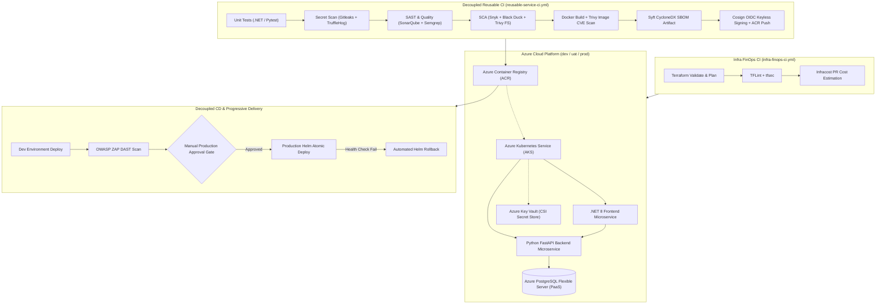

# AKS Polyglot Microservices DevSecOps & FinOps Platform

[](https://github.com/rahulgoyaldevops/aks-microservices-devsecops-platform/actions/workflows/ci-microservices.yml)
[](https://github.com/rahulgoyaldevops/aks-microservices-devsecops-platform/actions/workflows/infra-finops-ci.yml)

> **Enterprise Reference Architecture** for Production-Grade Polyglot Microservices (**.NET 8** + **Python FastAPI** + **Azure PaaS**) featuring **Reusable Decoupled DevSecOps CI/CD**, multi-layer **SAST/DAST/SCA**, **CycloneDX SBOM**, **Keyless Cosign OIDC Signing**, **Infracost FinOps**, and **Helm Atomic Auto-Rollback** on **Azure Kubernetes Service (AKS)**.

---

## Executive Architecture



---

## DevSecOps & FinOps Toolchain

| Domain | Tool / Service | Purpose |
| :--- | :--- | :--- |
| **Secret Detection** | Gitleaks & TruffleHog | Pre-build credential & secret leak prevention |
| **SAST & Code Quality** | SonarQube & Semgrep | Static analysis, code smells, and OWASP security rules |
| **SCA & Dependencies** | Snyk & Black Duck | Third-party dependency vulnerability & license compliance |
| **Filesystem & Image Scan** | Trivy (FS & Image) | OS package, container image, and IaC CVE scanning |
| **SBOM Generation** | Syft (CycloneDX) | Software Bill of Materials generation and artifact retention |
| **Supply Chain Signing** | Sigstore Cosign (OIDC) | Keyless container image signing and provenance verification |
| **DAST** | OWASP ZAP | Automated dynamic application security testing in Dev |
| **IaC & Policy** | Terraform, TFLint, tfsec | Infrastructure provisioning, linting, and security checks |
| **Cloud FinOps** | Infracost | Automated cloud cost delta estimation on Pull Requests |
| **Delivery & Rollback** | Helm (`--atomic`) | Zero-downtime deployments with automatic rollback on failure |

---

## Quickstart: Parameterized Environments (`dev`, `uat`, `prod`)

All CI/CD workflows are decoupled and parameterized for `dev`, `uat`, and `prod` environments.

### 1. Configure Repository Secrets & Variables
Add the following optional/required secrets in **Settings -> Secrets and variables -> Actions**:
- `SONAR_TOKEN` & `SONAR_HOST_URL` (SonarQube SAST)
- `SNYK_TOKEN` (Snyk SCA)
- `BLACKDUCK_API_TOKEN` & `BLACKDUCK_URL` (Black Duck SCA)
- `AZURE_CLIENT_ID`, `AZURE_TENANT_ID`, `AZURE_SUBSCRIPTION_ID` (OIDC Federated Credentials for ACR/AKS)
- `ACR_LOGIN_SERVER` (e.g., `myacr.azurecr.io`)
- `INFRACOST_API_KEY` (Infracost FinOps)

### 2. Trigger CI Manually or via Git Push
- **Automatic**: Push or open a Pull Request to `main` to run `ci-microservices.yml` for both `frontend-dotnet` and `backend-python` (defaults to `dev`).
- **Parameterized Dispatch**: Navigate to **Actions -> Microservices CI -> Run workflow**, and select the target environment (`dev`, `uat`, or `prod`).

### 3. Local Development
```bash
# Run .NET 8 Frontend tests
dotnet test src/frontend-dotnet

# Run Python FastAPI Backend tests
pytest src/backend-python
```
